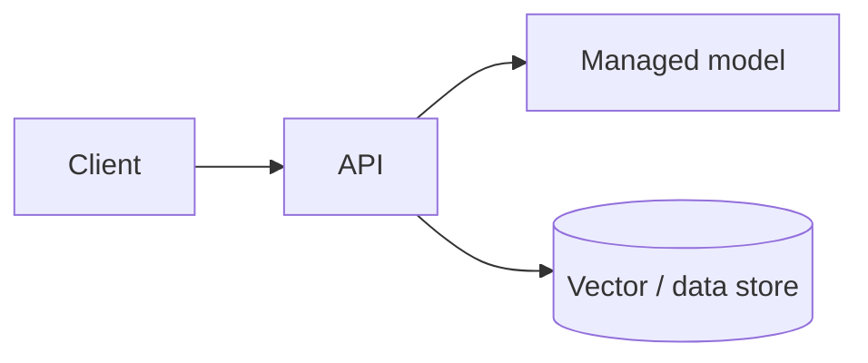

# {{TITLE}}

> Section {{SECTION}} · template: {{TYPE}} · started {{DATE}}

⚠️ **Cloud resources cost money.** Fill in `COST.md` before you deploy, set a budget alert, and work through `TEARDOWN.md` when you finish.

## Prompt
<!-- What you're building and why it belongs on this cloud. -->

## Requirements
- [ ]

## Architecture

## Services used
| Service | Why | Region | Tier / SKU |
|---|---|---|---|
| | | | |

## Identity and access
<!-- Which identities call what; least-privilege permissions; no long-lived keys if you can avoid them. -->

## How I'll know it works
<!-- Tests (offline with fakes, plus RUN_LIVE=1 tests against the real service), latency and cost. -->

## Follow-ups (the interviewer changes the rules)
- Make it private (no public endpoints)
- Make it multi-region
- Do the same thing on the other cloud

## Tradeoffs
<!-- Managed service vs self-built; cost; lock-in. -->
