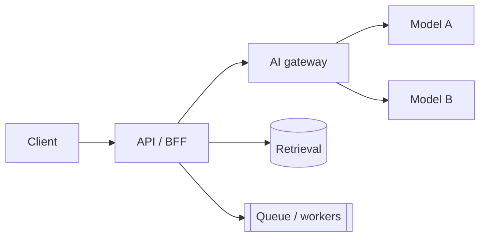

# Design — {{TITLE}}

## 1. Requirements recap

## 2. API
<!-- Endpoints with request/response shapes; streaming? -->

## 3. High-level architecture

## 4. Data model and storage
<!-- Documents, chunks, embeddings, conversations, memory, traces. -->

## 5. Model strategy
<!-- Which models where, routing, fallbacks, caching, fine-tuning or not. -->

## 6. Evaluation
<!-- Offline eval sets, online metrics, release gates. -->

## 7. Safety and security
<!-- Prompt injection, PII, tool permissions, tenant isolation. -->

## 8. Cost and latency
<!-- Per-request cost, where the latency goes, how you'd cut both. -->

## 9. Tradeoffs and alternatives
| Decision | Chose | Alternative | Why |
|---|---|---|---|
| | | | |

## 10. What breaks at 10× scale
